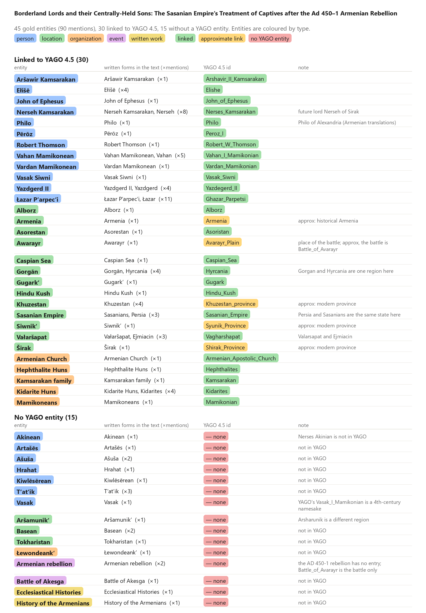
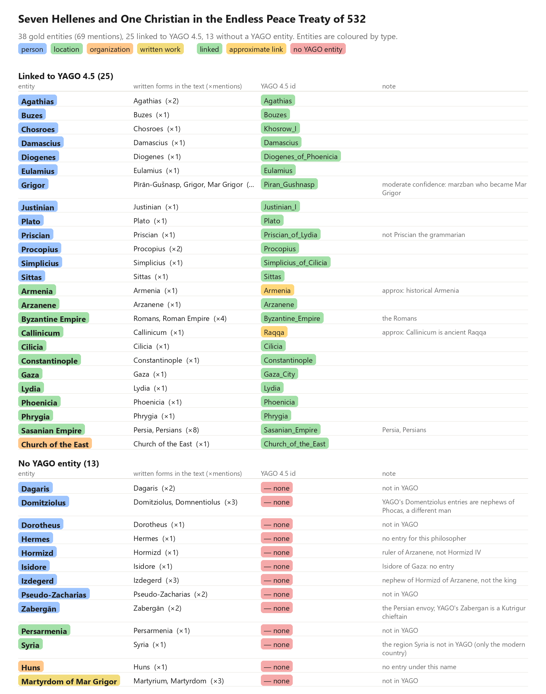

# Gold entity linking

The gold entities of each paper with the YAGO 4.5 id they are linked to. Entities are coloured by type; the id is green when
the link is exact, amber when only an approximate entry exists (the note says `approx`) and red when YAGO has no entity
(`yago: null`, a system should leave such mentions unlinked).

## Alford 2026, *Borderland Lords and their Centrally-Held Sons* (45 entities, 30 linked)

## Nechaeva 2017, *Seven Hellenes and One Christian in the Endless Peace Treaty of 532* (38 entities, 25 linked)

