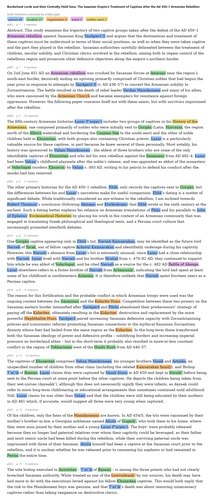
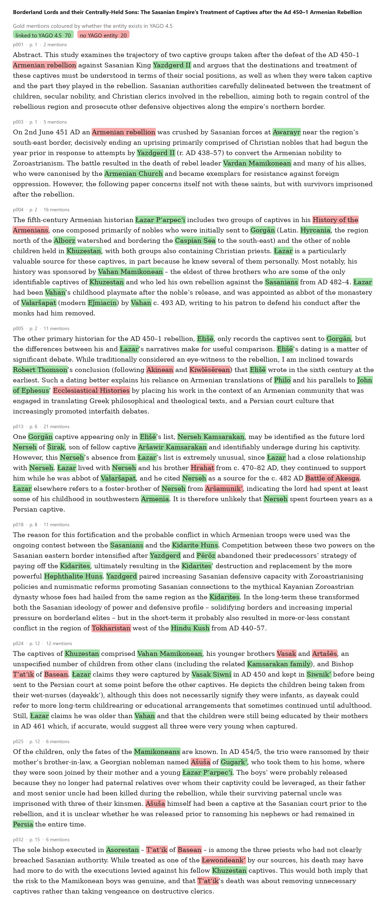
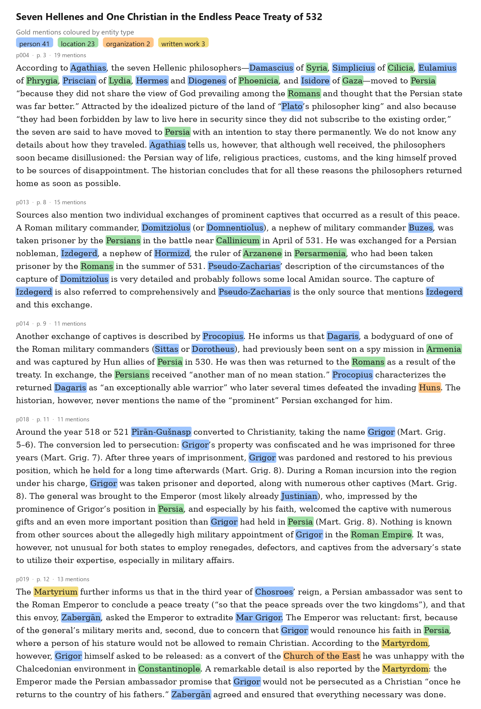
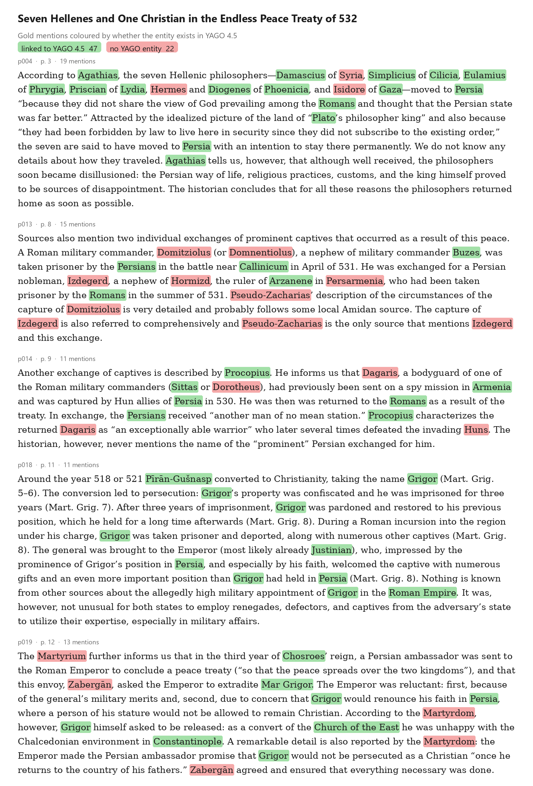

# Gold mentions

The 14 paragraphs with the gold mentions highlighted. Each paper is shown twice: coloured by entity type, and coloured by
whether the entity exists in YAGO 4.5.

## Alford 2026, *Borderland Lords and their Centrally-Held Sons*

By entity type:

By YAGO link (green: linked to YAGO 4.5, red: no entity in YAGO):

## Nechaeva 2017, *Seven Hellenes and One Christian in the Endless Peace Treaty of 532*

By entity type:

By YAGO link (green: linked to YAGO 4.5, red: no entity in YAGO):

