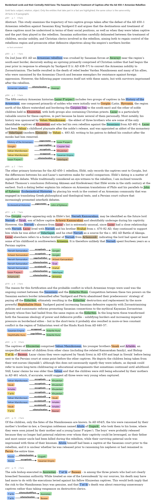
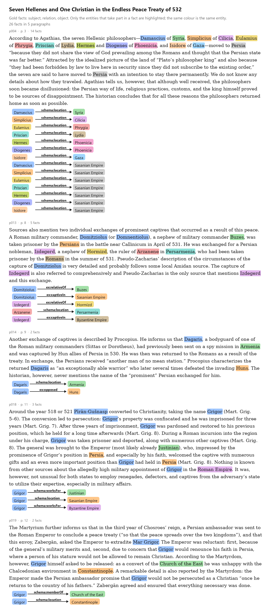

# Gold relations

The 14 paragraphs with the gold facts (subject, relation, object). Only the entities that take part in a fact are highlighted;
the same colour is the same entity, and the chips under each paragraph repeat the fact with the entity's label (which can
differ from the wording in the text, for example "Persia" is the Sasanian Empire).

## Alford 2026, *Borderland Lords and their Centrally-Held Sons* (28 facts)

## Nechaeva 2017, *Seven Hellenes and One Christian in the Endless Peace Treaty of 532* (26 facts)

